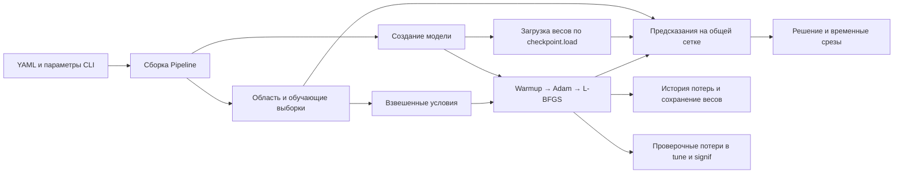

# PINN. Справочник по проекту

Этот документ описывает репозиторий PINN и позволяет отвечать на вопросы о запуске,
конфигурации, реализации задач и расширении платформы. Пути отсчитываются от корня
репозитория. Для точных значений конкретного запуска используй итоговую конфигурацию
Hydra. Значения из командной строки, YAML задачи и схемы фабрики могут отличаться.
Для ответов о конкретном запуске сначала уточни имя задачи, набор моделей и режим
работы. Обычный запуск может загружать веса, обучение начинается для меток вне
`checkpoint.load`, а оба исследования Optuna выбирают одну метку из `models`.

## 1. Назначение и ключевые понятия

Сеть аппроксимирует решение дифференциального уравнения как функцию координат
`model(t, x)`. Точки начального и граничного условий задают целевые значения или
связь между предсказаниями. В точках коллокации PyTorch дифференцирует предсказание
по координатам, чтобы получить невязку PDE. Обучение минимизирует взвешенную сумму
потерь по выбранным условиям. Общая функция потерь по умолчанию вычисляет средний
квадрат невязки. Аппроксимация строится по уравнению и условиям задачи, поэтому для
обычного запуска достаточно конфигурации и координатной сетки.

Конфигурация Hydra описывает состав эксперимента. Сборщик переводит её в
ориентированный ациклический граф операций. Каждая модель проходит свою цепочку
тренеров. После обучения или загрузки весов все модели вычисляют решение на общей
сетке. Для исследовательских запусков Optuna оценивает обученные модели по PDE,
начальному и граничному условиям на отдельных проверочных выборках.



## 2. Запуск

Проект использует Python 3.13, `uv` workspace и `uv.lock`. Из корня репозитория
подготовь окружение и проверь конфигурацию.

```bash
uv sync --locked
uv run experiments --config-name burgers --cfg job
```

Команда `experiments` вызывает `experiments.__main__:main`. Три формы запуска
исполняют одно приложение Hydra. Без `--config-name` оно выбирает `transport`.

```bash
uv run experiments --config-name transport
uv run python -m experiments --config-name transport
uv run python -m experiments.pinn --config-name transport
```

В текущем `transport.yaml` все три метки находятся в `checkpoint.load`.
Команды выше ожидают готовые веса и строят по ним графики. Чтобы обучить
модели заново, добавь `'checkpoint.load=[]'`. При стандартном
`checkpoint.save=true` новые веса записываются по прежним путям. Для проверки
запуска с сохранением прежних весов используй `checkpoint.save=false` или задай
другой `checkpoint.dir`. Короткий пример ниже запускается без сохранённых весов.

### Короткая проверка на CPU

Этот запуск оставляет одну небольшую MLP, делает по одному шагу Adam в двух стадиях
и ограничивает L-BFGS одной внутренней итерацией. Он проверяет обучение и построение
графиков. Hydra пишет результаты в каталог запуска.

```bash
uv run experiments --config-name burgers \
  device=cpu '~models.kan_spline' 'models.mlp.features=[2,8,1]' \
  'domain.steps=[12,12]' samples.initial.count=8 samples.boundary.count=8 \
  samples.pde.count=16 stages.warmup.trainer.epochs=1 \
  stages.adam.trainer.epochs=1 stages.lbfgs.trainer.maxIter=1 \
  checkpoint.save=false plots.slices.show=false
```

Для запуска с уже подготовленной `.venv` можно использовать
`uv run --no-sync ...` или `.venv/bin/python -m experiments.pinn ...`.
Устройство `device` по умолчанию задаётся как `${pick_device:auto}`.
Резолвер выбирает CUDA, если `torch.cuda.is_available()` истинно, иначе CPU.
Явные формы включают `device=cpu`, `device=cuda` и `device=cuda:1`.
Параметр `dtype` действует и на сетку, и на модели. В `base.yaml` стоит
`float64`. Для запуска с другой точностью задай, например, `dtype=float32`.

### Выходы, графики и веса

- Hydra сохраняет лог и снимок настроек в каталоге запуска, обычно под `outputs/`.
  В `.hydra/` доступны `config.yaml`, `overrides.yaml` и `hydra.yaml`.
  `hydra.run.dir=...` задаёт собственный каталог.
- `plotDir` по умолчанию указывает на подкаталог `plots/` текущего запуска.
  Там сохраняются `<label>_loss.png`, `solution.png` и `slices.png`.
  Для нескольких выходов фигуры срезов получают суффиксы, например
  `slices_h.png` и `slices_q.png`.
- `plots.slices.times` задаёт моменты времени. Для каждого значения выбирается
  ближайшая линия сетки, в заголовке указывается её фактическое время.
  Значения времени должны лежать внутри области.
  `plots.slices.show=false` отключает окно. `plotDir=null` отключает запись PNG.
  Для запуска без GUI можно задать `MPLBACKEND=Agg` и выключить нужные `show`.
- `checkpoint.save=true` сохраняет `state_dict` в
  `checkpoints/<config_name>/<label>.pt`. Каталог задаёт `checkpoint.dir`.
  `checkpoint.load` перечисляет метки для загрузки весов и перехода прямо к
  предсказаниям. Остальные модели обучаются. Конфигурация модели при загрузке
  должна соответствовать сохранённым весам. По умолчанию загрузка строгая.
  `strict=false` допускает пропущенные и лишние ключи, а размеры общих тензоров
  всё равно должны совпасть. Файл хранит состояние модели, включая её буферы.
  При смешанном запуске `checkpoint.load=[mlp]` загружает MLP и обучает
  остальные выбранные модели. Если модель исключена через `~models.<label>`,
  убери её метку из `checkpoint.load` той же командой.
- Узел-тренер возвращает историю и оптимизатор в памяти. В терминальный отчёт
  попадают число обучаемых параметров, число записей истории и последние потери
  по стадиям либо путь загруженных весов.

```bash
uv run experiments --config-name burgers \
  'plots.slices.times=[0.0,0.25,0.5,1.0]' plots.slices.show=false

uv run experiments --config-name burgers \
  '~models.kan_spline' 'checkpoint.load=[mlp]' plots.slices.show=false
```

Сообщение `FigureCanvasAgg is non-interactive, and thus cannot be shown`
означает, что Matplotlib попытался открыть окно с бэкендом `Agg`.
Срезы записываются перед `plt.show()`. Путь виден в строке `[plot] slices:`,
если задан `plotDir`. Для PNG достаточно `plots.slices.show=false`.
На локальном рабочем столе можно выбрать интерактивный бэкенд, например
`MPLBACKEND=TkAgg` при доступных Tk и графической сессии.

## 3. Задачи и модели

Основные YAML находятся в `experiments/src/experiments/pinn/conf/`. Имена
`domain.start`, `domain.end` и `domain.steps` перечисляют оси в порядке `[t, x]`.
Вход модели всегда содержит два признака. Для скалярной PDE выход имеет ширину 1.
Для мелкой воды и PCPW ширина выхода равна 2. Список `features` включает вход,
скрытые слои и выход. Например, `[2,32,32,1]` задаёт два скрытых слоя по 32.

| `--config-name` | Координаты и условия | Метки моделей |
| --- | --- | --- |
| `burgers` | `t∈[0,1], x∈[-1,1]`. Невязкое уравнение `u_t + u u_x = 0`. Начальное `u(0,x)=-sin(πx)`. На обоих краях `u=0`. | `kan_spline`, `mlp` |
| `transport` | `t∈[0,5], x∈[0,6]`. Уравнение `u_t + cos(πx) u_x = 0`. Начальное `max(0,min(x-1,5-x))`. На обоих краях `u=0`. YAML загружает веса всех выбранных моделей. | `kan_spline`, `kan_cheby`, `mlp` |
| `shallow` | `t∈[0,3], x∈[0,10]`. Мелкая вода, `g=10`. Начальные `u=2 sin(2πx/L+π/4)`, `h=(u+10)^2/(4g)`, `q=hu`, `L=10`. Граница периодическая для обоих выходов. | `kan_spline`, `mlp` |
| `dam_break` | `t∈[0,0.2], x∈[0,2]`. Мелкая вода, `g=9.81`. Начальная высота 1.5 при `x<1`, 0.5 справа, `q=0`. Границы держат начальные значения соответствующей стороны. | `kan_spline`, `kan_cheby`, `mlp` |
| `hydr_jump` | `t∈[0,40], x∈[-500,500]`. Мелкая вода, скачок высоты с 1 до 2 при `x=0`. Начальный и граничный расход одинаковы и равны `sqrt(g*hLeft*hRight*(hLeft+hRight)/2)`, при `g=10` это `sqrt(30)`. Для обеих моделей YAML включает загрузку весов. Для обучения задай `checkpoint.load=[]`. | `kan_spline`, `kan_cheby` |

Мелкая вода использует выходы `(h,q)`, где `h` — высота, `q=hu` — расход.
Невязки равны `h_t+q_x` и `q_t+(q²/h+g h²/2)_x`. Код раскрывает производную
потока, вычисляя `q_t+2u q_x+(gh-u²)h_x` с `u=q/h`. Малые или нулевые
предсказанные `h` могут приводить к большим или нечисловым невязкам.

Опция `pde: pcpw` предназначена для собственной задачи с выходами `(H,q)`.
В коде невязки имеют вид `H_t+a q q_x` и `q_t+b H² H_x+c q²/H²`.
`a`, `b`, `c` настраиваются как `fluxCoefficient`, `heightCoefficient`,
`momentumCoefficient`. Множители `H²` вычисляются после ограничения `H`
снизу через `heightFloor`. Остальные части задачи выбирает её YAML.

| Опция группы `model` | Реализация и параметры |
| --- | --- |
| `mlp` | `MLP`, полносвязная сеть с `Tanh` на скрытых слоях и линейным выходом. `features` и `seed` задаются в конфиге модели. |
| `kan_bsplines` | `KANModel` из `BsplineKANLayer`. Основные поля `features`, `intervalsCount`, `degree`, `initScheme`, `initAlpha`, `initBeta`, `inputBoundary`, `seed` и параметры обновления сетки. |
| `chebykan` | `ChebyKANModel`, слои на полиномах Чебышёва. Настраиваются `features`, `degree`, инициализация, `inputBoundary` и `seed`. |

`inputBoundary` при задании имеет вид `[[min_t,min_x],[max_t,max_x]]`.
Для B-spline KAN `gridUpdateEvery=0` отключает обновления. Положительный
интервал и `gridUpdateUntil` задают кратные интервалу шаги до указанной границы
включительно. Счётчик общий для всех стадий модели. L-BFGS в текущем тренере
делает один внешний шаг и может вызвать `closure` несколько раз. На шаге
обновления KAN собирает входы из вызовов `forward`, прореживает их до
`gridPointsCount` и проверяет допустимые изменения предсказаний и якобиана.

## 4. Как составить и проверить конфигурацию

### Слои Hydra

1. `conf/base.yaml` подключает общие операции через `defaults`. Здесь находятся
   выборки, расписание, веса условий, параметры обучения, графики, устройство,
   точность и чекпойнты. Запись `- tune` подключает `conf/tune.yaml` с настройками
   Optuna в корневых секциях `tune_config` и `signif_config`.
2. YAML задачи подключает `base` и выбирает опции групп `domain`, `pde`,
   `initial`, `boundary` и `model`. Запись `model@models.mlp: mlp` помещает
   выбранную опцию `model/mlp.yaml` в `cfg.models.mlp`. `mlp` слева от выбора
   опции выступает как метка модели и может быть заменена, например, на `small`.
3. Каждая YAML-опция включает в `defaults` схему `<name>_schema` и `_self_`.
   Схема приходит из Python `ConfigStore`, задаёт типы, значения по умолчанию
   и `_target_`. `_self_` после подключений позволяет полям текущего YAML
   переопределять загруженные значения.
4. Hydra накладывает аргументы CLI и передаёт итоговый `DictConfig` в
   `buildPipeline(cfg)`. `--cfg job` позволяет увидеть композицию без обучения.

Чтобы проследить подключение файлов, выведи дерево `defaults`. Чтобы проверить
значение одной секции с разрешёнными интерполяциями, укажи `--package` и `--resolve`.

```bash
uv run experiments --config-name transport --info defaults-tree
uv run python -m experiments.pinn.signif --config-name transport \
  --cfg job --package signif_config --resolve tune_config.model=mlp
```

Для `transport` дерево показывает `transport → base → tune`, а второй
вызов выводит `model: mlp` в секции `signif_config` по ссылке на `tune_config.model`.
При выводе всей конфигурации с `--resolve` подставь `plotDir=null`, чтобы
Hydra могла разрешить остальные параметры до создания каталога запуска.

| Группа | Опции в репозитории |
| --- | --- |
| `domain` | `rect` |
| `pde` | `burgers`, `transport`, `shallow_water`, `pcpw` |
| `initial` | `sine`, `cos`, `hat`, `step`, `shallow_wave`, `dam_break`, `hydraulic_jump` |
| `boundary` | `constant`, `periodic`, `dam_break`, `hydraulic_jump` |
| `sample` | `random`, `validate_random` |
| `loss` | `mse` |
| `condition` | `weighted` |
| `model` | `mlp`, `kan_bsplines`, `chebykan` |
| `trainer` | `adam`, `lbfgs` |
| `evaluator` | `grid` |
| `plot` | `loss`, `solution`, `slices` |

Фабрики `nodes.py` для разных опций одной группы соблюдают общий контракт входов
и выходов. `domain` и `model` получают `dtype` и `device` из сборщика,
а `trainer` получает `modelName` для логов. Эти параметры исключены из их
схем. Общие настройки меняются в корне конфигурации.

### Пример новой задачи из существующих опций

Сохрани следующий файл как `conf/transport_small.yaml` внутри пакета
`experiments.pinn`. Настройки `samples` задают число случайно выбранных
точек. `schedule` определяет реально создаваемые стадии.

```yaml
defaults:
  - base
  - domain: rect
  - pde: transport
  - initial: hat
  - boundary: constant
  - model@models.small: mlp
  - _self_

device: cpu
domain: {start: [0.0, 0.0], end: [1.0, 6.0], steps: [21, 31]}
boundary: {value: 0.0}
models:
  small:
    features: [2, 16, 16, 1]
samples:
  initial: {count: 16}
  boundary: {count: 16}
  pde: {count: 64}
schedule: [warmup, adam]
stages:
  warmup:
    trainer: {epochs: 2}
  adam:
    trainer: {epochs: 5}
checkpoint: {save: false}
plots:
  solution: {outputNames: [u]}
  slices: {outputNames: [u], times: [0.0, 0.5, 1.0], show: false}
```

```bash
uv run experiments --config-name transport_small --cfg job
uv run experiments --config-name transport_small
```

`features`, `domain.start/end/steps`, `plots.slices.times` и другие поля,
отмеченные `???` в подключённых шаблонах, заполняются в YAML задачи или через
CLI.

### Переопределения и ссылки

```bash
# Обучить модели с изменёнными параметрами MLP и Adam, сохранив прежние веса на диске
uv run experiments --config-name transport \
  'models.mlp.features=[2,32,16,1]' stages.adam.trainer.lr=0.0005 \
  'schedule=[warmup,adam]' 'checkpoint.load=[]' checkpoint.save=false

# Загрузить веса одной модели по метке
uv run experiments --config-name transport \
  '~models.kan_spline' '~models.mlp' 'checkpoint.load=[kan_cheby]'

# Добавить экземпляр опции mlp под новой меткой
uv run experiments --config-name burgers --cfg job \
  '~models.kan_spline' '~models.mlp' +model@models.small=mlp \
  'models.small.features=[2,8,1]'

# Заменить опцию под прежней меткой
uv run experiments --config-name transport --cfg job 'model@models.kan_cheby=mlp'
```

В CLI `a.b=value` переопределяет существующее поле, `+group@package=option`
добавляет выбор группы, `~a.b` удаляет запись. Кавычки вокруг списков, словарей
и аргументов с `~` сохраняют их для Hydra при обработке оболочкой. При замене
опции поля, указанные в YAML задачи для прежней опции, тоже участвуют в
композиции. Если они специфичны для прежней схемы, используй другую метку
или измени YAML.

В YAML возможны ссылки `'${stages.adam.condition.weights}'` или
`'${domain.start[1]}'`. В Python обращайся к модели с переменной меткой как
`cfg.models[label]` или `cfg["models"][label]`. Для добавления или удаления
ключей в структурированном `DictConfig` можно временно открыть узел.
Назначение существующего поля выполняется напрямую.

```python
from omegaconf import open_dict

label = "mlp"
cfg.models[label].features = [2, 16, 1]
with open_dict(cfg.models):
    del cfg.models["kan_spline"]
```

### Композиция и запуск из Python

Для запуска из скрипта или ноутбука можно собрать `DictConfig` через Hydra
Compose API. Импорт точки входа регистрирует резолвер `pick_device` и загружает
фабрики со схемами. В примере значения `plotDir` и `checkpoint.dir` заданы
явно, чтобы сборщик мог прочитать их без `HydraConfig` команды.

```python
import experiments.pinn.__main__  # регистрация резолвера и схем Hydra
from hydra import compose, initialize_config_module

from experiments.pinn.build import buildPipeline, report, setup

with initialize_config_module(config_module="experiments.pinn.conf", version_base=None):
    cfg = compose(
        config_name="burgers",
        overrides=[
            "device=cpu",
            "~models.kan_spline",
            "models.mlp.features=[2,8,1]",
            "domain.steps=[12,12]",
            "samples.initial.count=8",
            "samples.boundary.count=8",
            "samples.pde.count=16",
            "schedule=[adam]",
            "stages.adam.trainer.epochs=1",
            "checkpoint.dir=checkpoints/burgers",
            "checkpoint.save=false",
            "plotDir=null",
            "plots.slices.show=false",
        ],
    )
setup(cfg)
built = buildPipeline(cfg)
built.pipe.run()
report(built)
```

### Генерация опций и схемы

```bash
uv run python -m experiments.pinn.genconf
# Явная перезапись существующих шаблонов значениями из фабрик
uv run python -m experiments.pinn.genconf --overwrite
```

Генератор импортирует `experiments.pinn.nodes`. `write_config_tree()` записывает
шаблоны фабрик под `conf/<group>/<name>.yaml`. В обычном режиме существующие файлы
пропускаются. `--overwrite` перезаписывает их значениями из схемы и может затереть
ручные изменения. Файлы задач вроде `transport.yaml` составляются вручную.
Если у фабрики появилось новое поле, схема обновляется при импорте. Когда нужно
отразить поле в существующем YAML, обнови его точечно или проверь изменения
после полной перегенерации. Вложенные группы поддерживаются, например
`group="a/b/c"` создаёт `conf/a/b/c/<name>.yaml` и схему в группе `a/b/c`.

В `pinn_platform/conf/configuration.py` декоратор `@hydra_config` строит
dataclass `.Config` по сигнатуре функции или `__init__` класса. При
указанном `name` dataclass регистрируется в `ConfigStore` как
`<name>_schema`. `.from_config(cfg, **runtime)` декодирует поля и вызывает
функцию или конструктор. Сгенерированный `_target_` указывает на этот метод.
Аннотации и значения по умолчанию определяют поля схемы, аргументы без значения
по умолчанию получают `???`. `exclude=(...)` оставляет runtime-аргументы вне
схемы. `make(cfg, **runtime)` использует `hydra.utils.instantiate` и проверяет,
что результат является `Operation`. Для графиков сборщик вызывает известные
фабрики через `.from_config`, передавая пути файлов.

`register_type(py_type, yaml_type, encode=..., decode=...)` добавляет преобразование
для типа Python, которому нужно YAML-представление. `encode` подготавливает
значение по умолчанию к записи, `decode` переводит значение из конфига перед
вызовом фабрики. Например, кодек `torch.dtype` хранит `torch.float32` как
строку `"float32"` и читает её через `getattr(torch, value)`.
`torch.dtype` и `torch.device` уже зарегистрированы. Декоратор образует схему
во время импорта, поэтому пользовательский кодек регистрируется до объявления
использующей его фабрики.

## 5. Как данные движутся по графу

### Платформенный контракт

- `Artifact(value, meta)` переносит значение и словарь метаданных. Значением
  может быть тензор, модель, функция, условие, оптимизатор или число.
- `Operation.run(inputs: OpArg) -> OpArg` читает словарь именованных
  артефактов, выполняет работу и возвращает словарь именованных результатов.
  Операция с побочным эффектом может вернуть `{}`.
  `getMeta()` позволяет описать операцию в метаданных артефакта.
- `PipelineNode(operation, inputs, name=...)` связывает локальные имена
  входов с парами `(узел-источник, имя_выхода)`. `node.results` доступен
  после исполнения. `node.was_executed` отвечает за повторное использование
  результата. Артефакты передаются по ссылке.
- `Pipeline` хранит прямые и обратные зависимости и выполняет узлы в
  топологическом порядке. Валидация обнаруживает циклы, неподключённые входы и
  чтение от узлов вне цепочки зависимостей. Наличие конкретного выхода
  проверяется при его чтении. `place(pipe, name, operation, **inputs)` создаёт
  узел и проводит рёбра от источников. При ручной сборке вызовы `pipe.add` и
  `pipe.connect` выполняются отдельно.
- `Path.parse("root/data/domain")` представляет путь в дереве групп.
  `pipe.group(Path.parse("root/custom"))` временно меняет текущую группу.
  `pipe.getNode(path)` возвращает узел. `GroupSystem` отвечает за имена и
  структуру групп, а порядок исполнения следует из рёбер графа.

### Ветки нормального эксперимента

| Место в DAG | Содержимое и связи |
| --- | --- |
| `root/data` | `domain` строит сетку, `parts` разбивает её, узлы `initial`, `boundary`, `pde` отбирают строки. Узлы `*_source` превращают данные в источники точек. |
| `root/problem` | `pde` выдаёт функцию невязки, `loss` выдаёт функцию потерь. Из них и источников строятся `initial`, `boundary`, `pde_condition`. |
| `root/stages/<stage>` | Общий для моделей узел, собирающий взвешенное условие для стадии. Имена входов совпадают с ключами `stages.<stage>.condition.weights`. |
| `root/models/<label>` | `model` создаёт сеть. Каждый тренер принимает текущую модель и условие своей стадии. Ветка либо обучает и при необходимости сохраняет веса в `save`, либо загружает их в `load`. Узел `evaluation` выдаёт прогноз на полной сетке. `loss_plot` получает истории тренеров при обучении. |
| `root/plots` | `solution` и `slices` получают домен и прогнозы по меткам моделей. |
| `root/validation` | В `tune.py` и `signif.py` добавляется отдельная ветка источников и условий. `score` получает модель последней стадии. |

`buildPipeline(cfg)` проверяет ссылки между элементами конфигурации,
создаёт окружение и возвращает `Built` с `env`, `pipe`, `models`, `trainers`,
`loaded`. Точка входа вызывает `setup(cfg)`, собирает граф, запускает
`built.pipe.run()` и печатает `report(built)`.

### Размерности, выборки и loss

`DomainRectProducer` использует `torch.linspace` и `torch.meshgrid`.
Для эксперимента `DomainParts` ожидает `(nt,nx,2)` с координатами `(t,x)`.
Начальная линия имеет форму `(nx,2)`, граница — `(nt-1,2,2)`, внутренние
точки — `((nt-1)*(nx-2),2)`. Граница и внутренность берутся для `t>t_start`.
В каждой строке граничной выборки лежит пара левой и правой точек при одном и
том же времени. Дирихле разворачивает пары в список точек, периодическое
условие сравнивает предсказания двух сторон каждой пары.

`samples.<initial|boundary|pde>.count` ограничивает количество строк обучающей
выборки. `null` берёт все строки, положительный размер ниже размера исходных
данных выбирает случайные строки без повторов. При размере выше доступного
числа строк берётся вся часть области. `samples.boundary.count` считает пары.
Базовые размеры в текущем `base.yaml` — 150, 100 и 16384 соответственно.
У каждой выборки собственный `samples.<имя>.seed`. Генератор отбирает
обучающую выборку до оптимизации, а каждый шаг читает все отобранные точки
условий своей стадии. Чтобы уменьшить объём работы на шаге, задай,
например, `samples.pde.count=2048`. `evaluator.batchSize` действует только
на предсказания после обучения и по умолчанию равен 65536.
Тренировочный `batch_size` с обновлением точек потребует доработки источников
и управления выборкой в пределах шага оптимизатора.

| Где возникает нагрузка | Как ограничить объём работы |
| --- | --- |
| Вычисление потерь при обучении | `samples.pde.count` для невязки PDE. Для других условий `samples.initial.count` и `samples.boundary.count`. |
| Оценка trial в Optuna | `tune_config.validation.count`, `initial_count` и `boundary_count` в той же секции. PDE-валидация строит граф производных по координатам. |
| Внутреннее состояние L-BFGS | `stages.lbfgs.trainer.historySize` ограничивает число хранимых пар векторов для приближения кривизны. В шаблоне стоит 100. |
| Предсказание после обучения | `evaluator.batchSize` делит прямой проход на пачки. Прогноз целиком и сетка остаются в памяти. |
| Построение области и хранение выходов всех моделей | `domain.steps` уменьшает число узлов сетки. Если исследуешь одну модель, в обычном запуске можно исключить остальные метки. |

`SampleSource` выдаёт вызываемый объект `Callable[[], Tensor]`. Он возвращает
готовый тензор или передаёт уже созданный вызываемый источник. Условия читают
точки при вычислении потерь. `ExpectedCondition` согласует `domain()` и
`expect()` по строкам. Экспериментальный `TargetConditionProducer` получает
точки один раз и рассчитывает целевые значения по этим же точкам.
`PDECondition` отсоединяет координаты, разворачивает их в `(N, inputs)`,
задаёт `requires_grad_(True)`, вычисляет прогноз и передаёт его вместе с
координатами в функцию PDE. `jacobian(y,x)` использует `create_graph=True`,
чтобы обратный проход невязки достиг параметров модели.
`WeightedAccCondition.evaluate(model)` выдаёт скаляр суммарной потери и
словарь уже взвешенных компонент для логов.

### Стадии, сиды и повторное выполнение

`schedule` по умолчанию содержит `warmup`, `adam` и `lbfgs`.
`warmup` использует начальное и граничное условия. `adam` добавляет PDE.
`lbfgs` наследует веса `adam` через интерполяцию. Базовые веса `initial`,
`boundary`, `pde` в полной сумме равны 100, 1 и 1. Чтобы изменить вес,
используй `stages.adam.condition.weights.pde=...`. Чтобы запустить выбранные
стадии, задай, например, `'schedule=[adam]'`.

В `base.yaml` лимиты равны 200 шагам warmup, 1646 шагам Adam и 1684
внутренним итерациям L-BFGS. `transport` задаёт 3000 для Adam и L-BFGS,
`hydr_jump` задаёт 2000. Базовый порог `stages.adam.trainer.lossThreshold`
равен `0.01`. Для прогона с фиксированным числом шагов Adam его можно отключить
параметром `stages.adam.trainer.lossThreshold=null`.

`AdamModelTrainer` вызывает оптимизатор один раз за шаг, ограниченный
`epochs`. `LBFGSModelTrainer` вызывает `optimizer.step(closure)` один раз,
а `maxIter` ограничивает внутренние итерации. История L-BFGS хранит потери
каждого вызова `closure`, включая линейный поиск. Динамический источник точек
для L-BFGS должен сохранять одну выборку для повторных вызовов `closure` за
внешний шаг. `lossThreshold` задаёт досрочную остановку, `logInterval` —
частоту записи. Вокруг шага могут вызываться хуки `NeuralNetwork.beforeOptim`
и `afterOptim`. Тренер переключает модель в `train()`, затем в `eval()`.

В обычном запуске `cfg.seed` задаёт глобальный сид PyTorch. Инициализация
сети отдельно использует `models.<label>.seed` в `FactoryModelProducer`,
а случайные обучающие выборки используют `samples.<имя>.seed`. Изменение
одного только `cfg.seed` в обычном запуске сохраняет заданные отдельно сиды
у этих фабрик. В исследованиях `seedTraining()` выводит сид модели и сиды
обучающих выборок из сида испытания. Сид проверочных точек задаётся отдельно.

`Pipeline.replaceNode(old, replacement)` сохраняет путь, исправляет привязки
потребителей и строит входящие рёбра по входам нового узла. Для сохранения
прежних рёбер порядка служит `keepIncomingEdges=True`.
`build.replace(built, old, operation)` создаёт новый узел с копией входов,
использует этот флаг и обновляет записи в `built.models` и `built.trainers`.
После серии замен вызови `built.pipe.commit()`, затем `built.pipe.run()`.
`commit()` инвалидирует результаты замен и потомков, остальные узлы берутся
из кэша. Новый узел наследует набор имён выходов, если прежний уже выполнялся.

`Pipeline._editedEdges()` составляет временные карты рёбер при удалении
или замене узла. Граф и новые привязки проходят валидацию до установки.
`removeNode()` требует, чтобы оставшиеся входы имели источники в графе,
и сбрасывает кэш после успешного удаления. При переисполнении обучения учти,
что тренер меняет модель на месте. Если заменить только поздний тренер,
кэш раннего тренера может содержать уже изменённую сеть. Для независимого
испытания пересоздавай модель или строй новый граф.

## 6. Как добавить операцию

### Выбрать место и контракт

1. Определи входы и результаты. Сохрани контракт группы, если операция должна
   заменять существующую опцию. Для новой роли определи её связи в сборщике.
2. Реализуй операцию в `packages/pinn_platform/src/pinn_platform/operation/`,
   если она общая для платформы. Специфичную для эксперимента логику помещай в
   `experiments/src/experiments/pinn/ops.py`. Переиспользуй существующие базовые
   операции, когда их входы и результаты подходят.
3. Если операцию нужно выбирать из YAML, добавь фабрику с `@hydra_config`
   в `experiments.pinn.nodes` или импортируй туда модуль, который её объявляет.
   Импорт нужен и приложению, и генератору схем. Имя параметра Python становится
   ключом YAML. Сгенерируй YAML-опцию и подключи её через `defaults`.
4. Если операция добавляет новый шаг, размести узел через `place()` в `build.py`.
   Входы задаются ссылками на выходы, перечисленные в `run()` источников.
   Для замены опции с тем же контрактом достаточно фабрики и выбора в YAML.
5. Проверь `--cfg job`, затем запусти маленькую сетку и одну модель на CPU.
   Для PDE отдельно проверь форму невязки и обратный проход по параметрам сети.

### Контракты групп

| Роль | Входы узла | Выходы и типы |
| --- | --- | --- |
| `domain` | Пустой словарь. `dtype` и `device` передаются фабрике. | `domain`, тензор сетки |
| `sample` | `data`, тензор или набор связанных тензоров | `data`, выборка. В текущем эксперименте источник получает тензор или готовую функцию. |
| `pde` | Пустой словарь | `pde`, функция `(prediction, points) -> residual` |
| `loss` | Пустой словарь | `loss`, функция `residual -> scalar_tensor` |
| `initial`, `boundary` | `domain` с функцией-источником и `loss` с функцией потерь | `condition`, экземпляр `Condition` |
| `condition` | Именованные `Condition` по ключам весов | `condition`, составное `Condition` |
| `model` | Пустой словарь. `dtype` и `device` передаются фабрике. | `model`, экземпляр `torch.nn.Module` |
| `trainer` | `model`, `condition`. `modelName` передаётся фабрике. | `model`, `history` со списком потерь, `optimizer` |
| `evaluator` | `domain` с сеткой, `model` | `values` формы `(*grid, outputs)` |
| `plot` | Для потерь истории по именам стадий. Для решения и срезов `domain` и прогнозы по меткам моделей. | `{}`, фигуры записываются или показываются при выполнении. |

### Пример новой PDE. Перенос с постоянной скоростью

В `packages/pinn_platform/src/pinn_platform/operation/pde.py` добавь класс.
Файл уже импортирует `torch`, `override` и базовый класс. Производные в
`jacobian` имеют порядок `[..., выход, вход]`.

```python
class ConstantAdvectionPDEProducer(PDETransformProducer):
    """Создаёт невязку уравнения u_t + speed * u_x = 0."""

    def __init__(self, speed: float):
        self._speed = speed

    @override
    def pde(self, y: torch.Tensor, x: torch.Tensor) -> torch.Tensor:
        _checkOutputs(type(self).__name__, y, 1)
        derivatives = jacobian(y, x)
        return derivatives[..., 0, 0:1] + self._speed * derivatives[..., 0, 1:2]
```

В `experiments/src/experiments/pinn/nodes.py` зарегистрируй фабрику.

```python
from pinn_platform.operation.pde import ConstantAdvectionPDEProducer

@hydra_config(name="advection_constant", group="pde")
def constantAdvectionPDE(speed: float = 1.0) -> Operation:
    """Уравнение переноса с постоянной скоростью."""
    return ConstantAdvectionPDEProducer(speed)
```

Выполни `uv run python -m experiments.pinn.genconf`. Новый файл
`conf/pde/advection_constant.yaml` будет содержать
`defaults: [advection_constant_schema, _self_]` и `speed: 1.0`.
Проверь новую опцию на задаче `transport_small` из раздела 4.

```bash
uv run experiments --config-name transport_small --cfg job \
  pde=advection_constant pde.speed=0.5
uv run experiments --config-name transport_small \
  pde=advection_constant pde.speed=0.5
```

Для постоянной записи в конфиге задачи замени элемент `- pde: transport`
в `defaults` на `- pde: advection_constant` и добавь поле
`pde: {speed: 0.5}` на верхнем уровне. Сборщик передаст источники и
функцию невязки в существующее `PDECondition`.

### Пример нового узла. Максимальный модуль прогноза

Определи в `experiments.pinn.ops` операцию, читающую результаты `evaluation`.

```python
class MaxAbsPrediction(Operation):
    """Вычисляет максимальный модуль предсказания по всей сетке."""

    @override
    def run(self, inputs: OpArg) -> OpArg:
        values = inputs["values"].value
        return {"maximum": Artifact(value=values.abs().amax().item(), meta=self.getMeta())}
```

В `build.py` импортируй класс, затем добавь блок в `buildPipeline()`
после формирования словаря `values`. Здесь каждый `source` уже имеет
тип `NodeInput`, потому что `_addModel()` возвращает пару
`(evaluation, "values")`.

```python
with built.pipe.group(ROOT / "diagnostics"):
    for label, source in values.items():
        place(built.pipe, label, MaxAbsPrediction(), values=source)
```

После `built.pipe.run()` число доступно через
`built.pipe.getNode(ROOT / "diagnostics" / label).results["maximum"].value`.
Добавь чтение в `report()`, если результат нужен в терминале.

### Типовые точки расширения

- **Начальный профиль или условие Дирихле.** Напиши функцию, принимающую
  `points` формы `(N,2)` и возвращающую `(N,outputs)`. Координата `x`
  берётся как `points[:, 1:2]`. Добавь фабрику группы `initial` или `boundary`,
  которая создаёт `TargetConditionProducer(target, label)`. Параметры профиля
  передаются через `functools.partial`, как в `damBreakInitial()`.
- **Другой тип условия.** Реализуй `Condition.__call__(model)` или оберни
  функцию в `FuncCondition`. Операция-производитель возвращает экземпляр как
  `condition`. Для граничной формулы, использующей согласованные левую и правую
  точки, читай целую пару из источника.
- **Новый оптимизатор.** Подкласс `StepModelTrainer` реализует
  `createOptimizer(model)` для обычного шага. Для оптимизатора с `closure`
  используй контракт `ModelTrainer` и посмотри `LBFGSModelTrainer`.
  Зарегистрируй фабрику группы `trainer` с runtime-аргументом `modelName`.
  Чтобы добавить стадию, подключи `condition@stages.<name>.condition: weighted`
  и `trainer@stages.<name>.trainer: <option>` в `defaults`, задай её веса и
  параметры и включи имя в `schedule`.
- **Новая архитектура.** Определи `nn.Module`, который принимает точки
  `(N,2)` и выдаёт `(N,outputs)`. В фабрике группы `model` передай
  создание сети в `FactoryModelProducer(factory, seed, device, meta)`.
  Оставь `dtype` и `device` runtime-аргументами. Для совместимости с
  `tune.py` и `signif.py` опиши размеры через `features`.
  Если нужны хуки оптимизатора, унаследуй `NeuralNetwork` и реализуй их.
- **Новый график.** Сохрани контракт истории или `domain` и прогнозов.
  Сборщик использует конкретные фабрики `nodes.lossPlot`,
  `nodes.solutionPlot`, `nodes.slicesPlot`. Для новой роли добавь вызов в
  сборщик, а для выбора реализации по `_target_` используй `make` и передай
  runtime-параметры, которые до этого передавались через `.from_config()`.

## 7. Подбор и важность гиперпараметров

```bash
uv run python -m experiments.pinn.tune --config-name transport 'checkpoint.load=[]'
uv run python -m experiments.pinn.signif --config-name transport 'checkpoint.load=[]'
```

Hydra загружает задачу из `--config-name` и получает секции
`tune_config` и `signif_config` из `tune.yaml`, подключённого в `base.yaml`.
Команды используют одну модель из `cfg.models` на исследование.
`tune.py` читает `tune_config.model`, `signif.py` читает
`signif_config.model`, который по умолчанию ссылается на `tune_config.model`.
Для Burgers и Shallow задай `tune_config.model=mlp` либо при запуске
`signif.py` укажи `signif_config.model=mlp`.

`prepareStudyConfig()` копирует конфиг задачи. Сначала функция проверяет,
что метка присутствует в `models` и допускает обучение, поэтому для
`transport` и `hydr_jump` обычно нужен `checkpoint.load=[]`. Затем она оставляет
выбранную модель, отключает чекпойнты, запись PNG и показ графиков. В графе по-прежнему
выполняются предсказания на сетке и построение фигур. Для исследования нужна
хотя бы одна стадия в `schedule`.

### `tune.py`

Задача Optuna минимизирует проверочные потери. В `tune.yaml`
по умолчанию выполняется 20 trials для `kan_cheby`. `suggest_int` выбирает
число скрытых слоёв от 1 до 10, ширины от 3 до 20, сид от 0 до 56854,
`adam_epochs` и `lbfgs_maxiter` от 500 до 3000. Границы берутся из
`tune_config`, а входная и выходная ширины из `features`.
`adam_epochs` применяется к `stages.adam.trainer.epochs`, а
`lbfgs_maxiter` к `stages.lbfgs.trainer.maxIter` при наличии этих стадий.
`warmup` выполняется по конфигу задачи.

Пайплайн строится один раз. Каждый trial заменяет модель, обучающие
выборки и нужные тренеры, вызывает `commit()` и запускает граф. Optuna
получает итоговое число от `root/validation/score`. Изоляцию обученных
весов между trials обеспечивает замена узла модели. Лучший trial
печатается в логе. В текущей реализации objective возвращает оценку после
обучения, а промежуточная метрика для pruning отсутствует.
Study создаётся в памяти со стандартным сэмплером Optuna. Сид обучения
влияет на результат конкретного trial. Сэмплер подбора создаётся без явно
заданного сида. Каждый новый запуск создаёт новое исследование.

```bash
uv run python -m experiments.pinn.tune --config-name burgers \
  device=cpu tune_config.model=mlp tune_config.n_trials=2 \
  'domain.steps=[12,12]' samples.initial.count=8 samples.boundary.count=8 \
  samples.pde.count=16 stages.warmup.trainer.epochs=1 \
  'tune_config.adam_epochs={low:1,high:2}' \
  'tune_config.lbfgs_maxiter={low:1,high:2}' tune_config.validation.count=16
```

### Подбор для нескольких моделей и применение результата

Метка из `tune_config.model` выбирает тип сети и её исходные параметры. Optuna
меняет скрытые слои внутри этого типа. Для сравнения всех моделей в задаче
можно передать Hydra несколько меток через multirun.

```bash
uv run python -m experiments.pinn.tune -m --config-name transport \
  'tune_config.model=kan_spline,kan_cheby,mlp' 'checkpoint.load=[]'
```

Hydra создаёт по одному запуску на метку. Каждый запуск делает
`tune_config.n_trials` испытаний, печатает свой `Best validation loss` и сохраняет
свой лог. При стандартных настройках логи лежат в отдельных подкаталогах
`multirun/`. Для сравнения результатов используй одинаковые область, проверочные
выборки и бюджет поиска. Параметры выбранной архитектуры можно воспроизвести по
логу или `study.best_params`, если `tune_config(cfg)` вызван из Python.

Например, при `countLayers=2`, `width_0=12` и `width_1=8` для скалярной
задачи задаётся `features=[2,12,8,1]`. Параметры `adam_epochs` и
`lbfgs_maxiter` перенеси в соответствующие тренеры. Для точного переноса сида
используй `build.seedTraining(cfg, label, best["seed"])` перед `setup(cfg)` и
`buildPipeline(cfg)`. Функция выставляет также сиды модели и обучающих
выборок. Поисковые диапазоны хранятся в `tune_config`, а параметры для
обычного обучения задаются в `models` и `stages`.

### Досрочное завершение trial

Если добавляешь pruning, передавай промежуточную метрику из шага обучения
через `trial.report(value, step)` и проверяй `trial.should_prune()`,
после которого можно прервать trial через `optuna.TrialPruned`. В текущем
графе validation зависит от последнего тренера. Для промежуточной оценки
нужен отдельный способ вызвать проверочное условие на текущей модели.
PDE-оценка требует градиентов по координатам даже при `model.eval()`.

### `signif.py`

Для каждого trial строится новый пайплайн. `RandomSampler` с
`signif_config.sampler_seed` выбирает категориальный сид из `seeds`,
категориальную архитектуру из `architectures` и числовые параметры активных
тренеров из `trainers`. Профили содержат только скрытые ширины. Для числовых
параметров задаются `low`, `high` и опциональный `log`. При `log: true`
поиск идёт в логарифмическом масштабе и требует положительных границ.
По умолчанию исследование делает 50 trials и выводит нормированные
важности PED-ANOVA для целевой доли лучших результатов `target_quantile=0.25`.
Рейтинг описывает выбранное пространство поиска. Для оценки нужны
завершённые trials с различающимися конечными потерями.

```bash
uv run python -m experiments.pinn.signif --config-name burgers \
  device=cpu signif_config.model=mlp signif_config.n_trials=8 \
  'domain.steps=[12,12]' samples.initial.count=8 samples.boundary.count=8 \
  samples.pde.count=16 tune_config.validation.count=16 \
  'signif_config.trainers.warmup.epochs={low:1,high:2}' \
  'signif_config.trainers.adam.epochs={low:1,high:2}' \
  'signif_config.trainers.lbfgs.maxIter={low:1,high:2}'
```

### Общая проверочная метрика

`_addValidation()` использует ту же сетку и те же формулы условий,
с отдельными источниками точек. `tune_config.validation.count` задаёт
число внутренних точек, `initial_count` и `boundary_count` — начальные
точки и граничные пары. `null` означает полную соответствующую часть.
Сид `tune_config.validation.seed` по умолчанию равен 2049. Потери трёх
условий суммируются с весом 1 для каждого. Проверочные точки по стандартным
настройкам одинаковы во всех trials и могут пересекаться с обучающими.
`signif.py` фиксирует все разрешённые параметры проверочной выборки
до смены сида обучения. `tune.py` повторно использует кэш проверочных узлов.

## 8. Где искать реализацию

| Путь от корня | Ответственность |
| --- | --- |
| `pyproject.toml`, `uv.lock`, `.python-version` | Workspace, версии зависимостей и Python, настройки Ruff и pytest. |
| `experiments/src/experiments/__main__.py`, `pinn/__main__.py` в том же пакете | Точки входа тренировки, выбор устройства и запуск Hydra. |
| `experiments/src/experiments/pinn/build.py` | Сборщик, окружение, сиды исследований, добавление и замена узлов, отчёт. |
| `experiments/src/experiments/pinn/nodes.py`, `ops.py` | Фабрики Hydra, области, профили, условия, модели и операции эксперимента. |
| `experiments/src/experiments/pinn/conf/`, `genconf.py` | YAML задач и опций, генерация шаблонов. |
| `experiments/src/experiments/pinn/tune.py`, `signif.py` | Optuna, критерий валидации, кэширование trial и исследование важности. |
| `packages/pinn_platform/src/pinn_platform/conf/configuration.py` | Декоратор, кодеки, регистрация схем и запись YAML. |
| `packages/pinn_platform/src/pinn_platform/core/` | `artifact.py` хранит данные, `node.py` разрешает входы и кэширует результат, `pipeline.py` управляет DAG, `groupsystem.py` реализует пути и группы. |
| `packages/pinn_platform/src/pinn_platform/operation/` | `_operation.py` определяет интерфейс, `producer.py` выпускает модели, сетки и функции, `converter.py` выбирает данные, `condition.py` считает потери, `pde.py` задаёт формулы. |
| Там же, `train.py`, `checkpoint.py`, `evaluator.py`, `visualizer.py` | Оптимизация, веса, предсказания на сетке, графики. |
| `packages/pinn_networks/src/pinn_networks/network.py`, `mlp/model.py` | Базовые хуки обучения и MLP. |
| `packages/pinn_networks/src/pinn_networks/kan/model.py`, `kan/bsplines/` | Сплайновая KAN, сетки, базис и слой, пересчёт коэффициентов и контроль точности. |
| `packages/pinn_networks/src/pinn_networks/kan/cheby/`, `kan/initial/` | Chebyshev KAN, базис Чебышёва и схемы инициализации KAN. |
| `packages/pinn_networks/src/pinn_networks/kan/kanlayer.py` | Прежний сплайновый слой. Фабрика `kan_bsplines` использует `BsplineKANLayer` из `kan/bsplines/layer.py`. |
| `README.md`, `READM.md`, `_info/info contex.md` | Быстрый старт, разбор функций с примерами и контекст для сопровождения. |

Узел графа `root/models/<label>/evaluation` использует
`ModelEvaluator` из `pinn_platform.operation.evaluator`. Проверочные потери в
Optuna вычисляет `ValidationScore` из `experiments.pinn.tune`. Прежний пакет
`pinn_platform.evaluation` удалён. Для внешних скриптов, которые импортировали
его, точка входа для предсказаний в текущем пайплайне — `ModelEvaluator`.
Старый экспорт HDF5 в текущую исполняемую цепочку не входит.

## 9. Диагностика частых ошибок

| Симптом | Что проверить |
| --- | --- |
| `MissingMandatoryValue: models.kan_spline.features` | Подключи нужную опцию `model@models.kan_spline: kan_bsplines` и задай `models.kan_spline.features` с двумя входами и подходящим числом выходов. Покажи композицию через `--cfg job`. |
| `Could not override ...` или `Key ... is not in struct` | Сверь точный путь и схему выбранной фабрики. Для добавления новой опции группы используй `+group@package=option`. Для списка в CLI используй кавычки. |
| Hydra не находит `*_schema` | Проверь `name` и `group` декоратора, `defaults` в шаблоне и импорт фабрики из `nodes.py`. |
| `schedule refers to stages ...` | Имена `schedule` должны совпасть с ключами `stages`, а активная стадия должна получить тренер и условие. |
| Ошибка `expected 1/2 model outputs` или несогласованные формы | Согласуй последний элемент `features`, PDE, форму начальных и граничных целей и названия выходов графиков. |
| `CUDA out of memory` при расчёте PDE | Уменьши `samples.pde.count`. Граф для производных по координатам и параметрам строится на всей выбранной порции. При необходимости уменьши модель, размеры сетки или задай `device=cpu`. |
| `CUDA out of memory` при предсказании | Уменьши `evaluator.batchSize` для прямого прохода частями. Память под всю сетку и результаты сохраняется, поэтому для большой задачи может потребоваться уменьшить `domain.steps`. |
| Ошибка файла чекпойнта или несовпадение размеров весов | Сверь `checkpoint.dir`, `checkpoint.load` и архитектуру при сохранении. Для нового обучения используй `checkpoint.load=[]`. |
| `checkpoint.load names unknown models` | После исключения модели через `~models.<label>` обнови и `checkpoint.load`. |
| Окно срезов задерживает завершение | Задай `plots.slices.show=false`. Запись изображений управляется `plotDir`. |
| `Pipeline.run: call commit() after replacing nodes` | После замен вызови `commit()` перед запуском. Убедись, что имена выходов совместимы с прежним узлом. |
| `study model ... is not selected` | Задай модель из `cfg.models` соответствующим параметром `tune_config.model` или `signif_config.model`. |
| `study requires training ...` | Убери выбранную модель из `checkpoint.load`. Для стандартного запуска Optuna на `transport` задай `'checkpoint.load=[]'`. |

Для трассировки ошибок внутри Hydra установи `HYDRA_FULL_ERROR=1`.
Для коротких технических проверок подойдут `uv run ruff check experiments`,
`uv run python -m compileall -q experiments/src packages` и пример CPU
из раздела 2. Настройки pytest описаны в `pyproject.toml`. В текущем дереве
репозитория нет набора автоматических тестов. Для CLI пользуйся точками входа
`experiments`: пакетная команда `pinn-platform` в своём `pyproject.toml`
указывает на отсутствующий модуль `pinn_platform.exc`.
